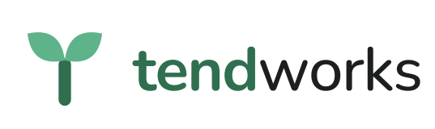
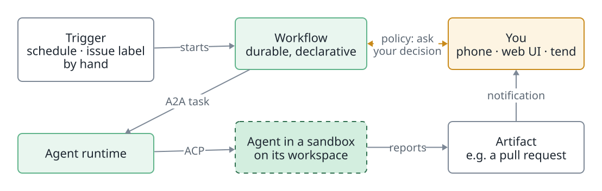
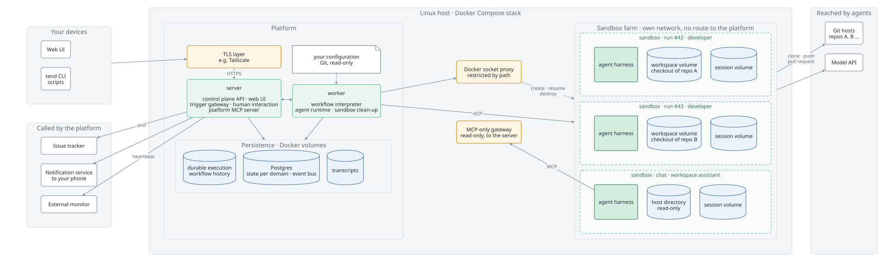

<h1>
  <picture>
    <source media="(prefers-color-scheme: dark)" srcset="docs/brand/logo-horizontal-dark.svg">
    
  </picture>
</h1>

**Agents that keep working while you are away. You keep the decisions that matter.**

[](https://github.com/mtiews/tendworks/actions/workflows/ci.yml)
[](docs/releases/)
[](LICENSE)


Tendworks (short: Tend) is a self-hosted, use-case-neutral platform for AI agents. Triggers start the agents, which run isolated and recoverable in sandboxes. You steer them through a web UI, chat or the `tend` CLI, and they only call on you when a policy says so.

> *Tend:* to care for something that grows. You plant the work, the platform tends it, and you come back to results and to the few decisions only you can make.

## Why Tendworks

Coding agents are good enough to do real work, but most setups still need a human at the keyboard: start the agent, watch it, restart it after a crash, copy the result somewhere. Tendworks turns agents into **unattended, accountable workers**.

### Durable agents

A run is a durable workflow, not a terminal session. If the platform restarts, the host reboots or a sandbox dies mid-run, the run resumes where it stopped: the workflow on durable execution, the agent session on its own volume. Transcripts and cost are recorded outside the sandbox, so you can always see what an agent did and what it cost, live or afterwards.

### Sandboxed agents

Agents are treated as **untrusted**. Each one runs in its own container (non-root, no privileges, gVisor as an opt-in), reaches Docker only through a restricted proxy, and holds only the narrowly scoped credential of its workspace. The platform's own MCP server is reachable from a sandbox only through an MCP-only gateway with a read-only token. Prompt injection is assumed to be the normal case: what an agent can do is limited by the platform, not by the model's good behavior.

### Triggered, not babysat

Trigger bindings start workflows by themselves: on a schedule, for every GitHub issue with a label, or by hand when you decide. One binding serves any number of workspaces (a git repository on any host, or a directory on the host). Nobody has to be at the keyboard for work to start, run and finish.

### The human out of the loop, but in charge

Your attention is the scarcest resource, so the platform spends it only where it counts:

- **Policies decide when to ask you,** not the workflow author case by case. A human step names an action and the answers it offers; a policy says `allow` or `ask`.
- **You are reached where you are:** subscriptions send the events you care about (run failed, approval requested, platform degraded) to your phone with the priority you choose, with a link straight to the pull request or the approval.
- **Critical decisions stay human:** the platform merges nothing. Agents open pull requests and report them; you review and merge.
- **You notice when it stops:** the platform watches its own health, and a heartbeat lets an external monitor alarm you when it is down.

### Open, declarative, replaceable

- **Standards at every seam:** A2A towards agents, ACP to the harness, MCP for tools, CloudEvents for events, OpenAPI for the API, CNCF Serverless Workflow for workflows. Any side of a boundary can be replaced without the other noticing.
- **No vendor lock-in:** harness, model, sandbox backend and notification channel each sit behind a port. Claude Code is the first harness, not the only possible one.
- **Everything as readable files in Git:** workflows in YAML, agent profiles as Markdown with frontmatter, skills as `SKILL.md`, trigger bindings, workspaces and policies with an `apiVersion/kind/metadata/spec` envelope.
- **No private back doors:** the web UI and the `tend` CLI are clients of the same public API as any script.

## How it works

<picture>
  <source media="(prefers-color-scheme: dark)" srcset="docs/diagrams/how-it-works-dark.svg">
  
</picture>

A workflow such as `develop-issue` hands an issue to the `developer` agent: the agent works on a checkout of the workspace in a sandbox, pushes a branch, opens a pull request and reports it. The run ends with the pull request as its artifact, and you get a notification with a tap to it.

```sh
tend status                              # what runs, what waits for you
tend run list                            # recent runs and their status
tend trigger fire playground-security-review --follow   # start a workflow by hand and follow it live
tend chat --workspace playground         # ask a read-only assistant about a workspace
```

### What runs on your host

One Linux host, one Docker Compose stack. The server is the only way in, the worker runs workflows and agents, and every agent session gets a sandbox of its own on its own workspace.

<picture>
  <source media="(prefers-color-scheme: dark)" srcset="docs/diagrams/architecture-dark.svg">
  
</picture>

| Part | Keeps what | Why it matters |
| --- | --- | --- |
| **server** | the public API, also for the web UI, `tend` and the platform MCP server | the only way in; it starts runs from triggers and asks you when a policy says so |
| **worker** | workflow interpreter and agent runtime | turns workflow steps into agent tasks, creates sandboxes, records transcripts and cost; removes orphaned sandboxes |
| **durable execution engine** | the history of every workflow | a run continues after a restart where it stopped |
| **Postgres** | the state of every domain in its own schema, and the event bus | runs, tasks, approvals and notifications survive restarts; backup and restore are one script each |
| **sandboxes** | one container per agent session, on its own network | agents never reach the server, the store or Docker; the platform MCP server only through the MCP-only gateway, read-only |
| **workspace and session volumes** | the agent's checkout and its harness session | outlive the sandbox: if a sandbox dies, a new one resumes the session on the same volumes |

## Use case: the AI-driven software factory

The first and driving application of Tendworks is a **software factory**: a repeatable, largely autonomous value stream that turns an idea into working, delivered software, where humans are involved only for real decisions. It is pure configuration on the platform: workflows, agent profiles, policies and skills; no factory code in the platform.

| Stage | Role(s) | Output | Gate |
| --- | --- | --- | --- |
| 1. Capture idea | Product Owner (human) | problem statement | — |
| 2. Validate requirement | Analyst, Critic, Architect | validated requirement with objections | human, if findings are unclear |
| 3. Specify | Analyst, Test Designer | specification + executable acceptance criteria | **human approves the specification** |
| 4. Design | Architect | design note, ADR if needed | automatic, except architecture changes |
| 5. Implement | Developer | pull request | evidence complete |
| 6. Verify | Reviewer, QA | evidence bundle | policy based on evidence |
| 7. Deliver and operate | Ops | release, monitoring findings | canary metrics, automatic rollback |

Its principles:

- **Human attention goes to the start of the chain** (what to build, the specification), not to reading code.
- **Evidence over trust:** every stage delivers its result with evidence, and only what the evidence supports moves on.
- **Author and reviewer are separate,** ideally with a different model or harness.
- **Autonomy is earned:** per workflow, from "every change approved" to "human only for hard gates", promoted by the measured hit rate, not by flipping a switch.

### Tendworks builds Tendworks

The factory is not a slide: Tendworks develops itself this way today. A human shapes a spec with an agent and splits it into tickets. `/handover` labels the first ticket `ready-for-agent`; the trigger starts one sandboxed agent run per ticket, which implements it test-first, runs the checks and a code review, pushes to the spec's branch, waits for CI and hands over the next ticket. The last run marks the pull request ready, and the human reviews and merges.

```text
 human                          trigger                     agent, one run per ticket
 ─────────────────────────      ─────────────────────────   ──────────────────────────────────
 spec + tickets  ─► /handover ─► issue labelled          ─► implement, test, review, push
                                 ready-for-agent             wait for CI, hand over next ticket
                                        ▲                                  │
                                        └──────────────────────────────────┘
 human: review and merge the pull request
```

See [docs/software-factory.md](docs/software-factory.md) for the full design and [docs/agents/agent-workflow.md](docs/agents/agent-workflow.md) for the workflow in practice.

### Beyond software

The platform is use-case neutral. The same building blocks can, for example, add intelligence to a home automation setup (home events as triggers, an agent decides, anything irreversible needs your approval) or run personal research and operations routines.

## Status

Tendworks is pre-1.0 and built for **one operator on one Linux host**. The automated path, chats, the web UI, single-host deployment, workspaces, trigger bindings and notification subscriptions work today. Identity (OIDC), the egress proxy for secrets, the egress allowlist and the Action Gateway are part of the target architecture but not built yet.

Milestones, releases and what is missing: [docs/status.md](docs/status.md).

## Getting started

Install a release on Ubuntu 24.04 with Docker Engine by following the [operator guide](docs/operator-guide.md#install): check out a release tag, create `deploy/.env` with `scripts/setup-env.sh`, copy `examples/config` as your own configuration, build the sandbox image and start the stack with Docker Compose.

## Documentation

| Document | For |
| --- | --- |
| [docs/status.md](docs/status.md) | milestones, releases and what does not exist yet |
| [docs/operator-guide.md](docs/operator-guide.md) | installing, running and updating Tendworks on your own Linux host: install from a tag, workspaces, trigger bindings, notifications, assistants, secrets, access from your devices, backup and restore, troubleshooting |
| [docs/github-agent-access.md](docs/github-agent-access.md) | the two GitHub tokens (issues token, agent token per workspace) and what they can and cannot do |
| [docs/sandbox-images.md](docs/sandbox-images.md) | sandbox images with your own tooling on top of the Tendworks images |
| [docs/releases/](docs/releases/) | release notes per tag: migrations, configuration changes, update steps |
| [docs/platform-architecture.md](docs/platform-architecture.md) | domains, seams and standards, data model, security, roadmap |
| [docs/platform-implementation.md](docs/platform-implementation.md) | tech stack, repo structure, walking skeleton, smoke tests, open items |
| [docs/software-factory.md](docs/software-factory.md) | the first application on Tendworks |
| [docs/adr/](docs/adr/) | architecture decisions |
| [GLOSSARY.md](GLOSSARY.md) | domain language |

## Development

Needs Node.js 24 and pnpm (`corepack enable pnpm`).

| Command | Does |
| --- | --- |
| `pnpm install` | installs dependencies and points git at the pre-commit hook (needs `betterleaks` on `PATH`) |
| `pnpm check` | generates types from `contracts/`, typechecks, lints, checks architecture rules, runs unit and view tests |
| `pnpm coverage` | unit and integration tests with coverage thresholds |
| `scripts/render-diagrams.sh` | renders the README diagrams from `docs/diagrams/*.d2` to SVG (needs [D2](https://d2lang.com) `v0.9.0`) |
| `pnpm build` | builds all packages, the `tend` CLI and the web UI |
| `pnpm e2e` | builds and starts the compose stack, then runs the end-to-end tests (API and browser) against it; needs `deploy/.env` from `scripts/setup-env.sh` |
| `node apps/cli/dist/main.js status` | the `tend` CLI against `http://localhost:8080` (after `pnpm build`) |

Contribution rules (contract-first, ports and adapters, no cross-domain imports) are in [CLAUDE.md](CLAUDE.md).

## License

[Apache License 2.0](LICENSE)
