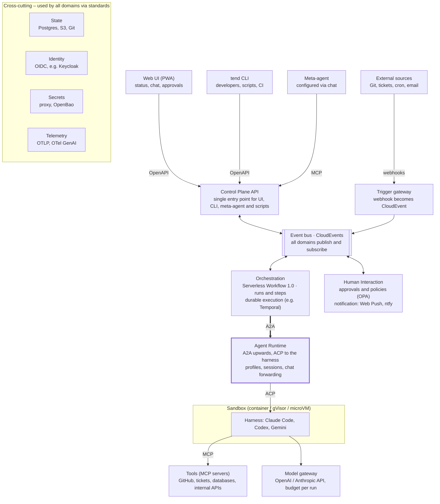

# Tendworks – Platform Architecture

Oct 18, 2026 · @Marcel

**Name:** Tendworks (short: Tend) is the name of this platform. Its command line is `tend`, its domain `tendworks.dev`. Core idea: agents run reliably while the human is away.

**Use-case neutral.** What runs on Tendworks is configuration, not platform code: workflows, agent profiles, policies, skills and integrations. The software factory (document "Software Factory on Tendworks") is the first and driving application, but not the only one. The same platform can, for example, add intelligence to a home automation setup (home automation events as triggers, an agent decides, actions go through the Action Gateway with an approval for anything irreversible), or run personal research and operations routines. A feature only goes into the platform if it is generic; anything specific to one application stays in that application's configuration.

## Target picture and architecture principles

The platform consists of clearly separated domains that talk to each other exclusively through open standards (MCP, ACP, A2A, CloudEvents, OpenAPI, OCI, S3, OIDC, OTLP). Either side of a boundary can be reimplemented without the other side noticing. The goal of the first step is a self-hosted agent platform: agents are started by triggers, run isolated and recoverable, can be controlled via web UI and chat, and only call on the human when needed.

**Principles**

1. **A domain owns its data.** No shared database between domains. Access only through the published API or events.
2. **Every boundary is a contract.** Synchronous as OpenAPI 3.1 (or a protocol standard such as MCP, A2A, ACP), asynchronous as CloudEvents, documented in AsyncAPI. Payloads as JSON Schema.
3. **Standards before custom builds.** Where a standard exists, it is used, even if it is not a perfect fit. Own contracts only where no standard exists (e.g. sandbox API, approval API), and then deliberately small.
4. **Ports and adapters inside every domain.** Concrete products (Temporal, NATS, Garage, LiteLLM …) sit behind an adapter. Product names appear in no contract.
5. **Everything declarative lives in Git.** Workflows, agent profiles, policies, triggers, infrastructure. Everything is human-readable: static things are structured files, runtime state lives in files or databases depending on the use case, but is always viewable and exportable in readable form.
6. **From the outside, all agents look the same.** Whether Claude Code, Codex, Gemini CLI or a custom agent: externally, every agent follows the A2A task model; as a real A2A network endpoint only once it is needed.
7. **The UI and the CLI are just clients.** They use the same public APIs as the meta-agent and any script. No private back doors. Scaling is a matter of configuration, not code: the same services run on the laptop and in the cluster.
8. **Replaceability is tested, not claimed.** Every boundary has contract tests and at least two implementations (the second may be a fake).

## Domain map

Eight domains plus four cross-cutting services, each with its own responsibility and its own data; the highlighted A2A boundary is the most important line of replaceability.



Arrows are contracts, not code dependencies. The agent runtime and all other domains also publish events to the bus; those lines are omitted for clarity.

## Seams and standards

By now there is an open standard for almost every boundary. Own contracts remain only for the sandbox, approvals and the control plane API; these are published as OpenAPI and kept small.

| Boundary (seam) | Standard | Maturity | What is replaceable behind it |
| --- | --- | --- | --- |
| External source → platform (trigger) | webhooks (HTTP), normalized to **CloudEvents 1.0** | stable (CNCF graduated) | GitHub, Forgejo, Jira, cron, email, chat |
| Domain ↔ domain (asynchronous) | **CloudEvents** over an event bus, described in **AsyncAPI 3** | stable | NATS JetStream, Redpanda, RabbitMQ |
| Domain ↔ domain (synchronous) | **OpenAPI 3.1** + JSON Schema | stable | any implementation of any domain |
| Workflow definition | **CNCF Serverless Workflow DSL 1.0** (YAML) | stable, runtimes still young | execution engine (Temporal, Synapse, Lemline, own interpreter) |
| Orchestration → agent | **A2A 1.0** (Agent2Agent) | stable since March 2026 | any agent, any role, including external agents |
| Agent runtime → harness | **ACP** (Agent Client Protocol) | de facto standard, young | Claude Code, Codex, Gemini CLI, OpenCode, Cursor CLI |
| Agent → tools and data | **MCP** | stable | GitHub, tickets, databases, internal APIs |
| Agent → knowledge and abilities | **Agent Skills** (SKILL.md) + **AGENTS.md** | widespread | skill libraries per role |
| Agent / gateway → model | OpenAI-compatible API (Chat Completions / Responses) and Anthropic Messages API | de facto standard | model providers, local models (vLLM, Ollama) |
| Runtime → sandbox | own **sandbox API** (OpenAPI), images as **OCI** | own contract | Docker (runc or gVisor), Kata, Firecracker, OpenSandbox, k8s agent-sandbox |
| Storage of artifacts and snapshots | **S3 API** + **Git** | stable | Garage, SeaweedFS, Ceph, any cloud storage |
| Identity | **OIDC / OAuth 2.1** | stable | Keycloak, Authentik, Zitadel |
| Secrets | secret store API behind an adapter; encrypted in Git with **SOPS** | no real standard | OpenBao, Infisical, cloud KMS |
| Telemetry | **OTLP** + OTel GenAI conventions | transport stable, GenAI conventions still "Development" | Grafana stack, SigNoz, Langfuse |
| Notification | **Web Push** (W3C) + HTTP push (ntfy) | stable | ntfy, Matrix, Slack, email |
| Runtime packages | **OCI images**, Compose spec | stable | Docker, Podman, Kubernetes |

**The most important boundary is A2A between orchestration and agent.** The orchestrator only sees "an agent with skills that accepts tasks". Whether Claude Code runs behind it via ACP in a Firecracker VM or an external service is invisible. The A2A task status *input-required* is also the hook for questions and chat.

**Note on the name clash:** "ACP" here means the *Agent Client Protocol* (editor/client ↔ coding agent). An earlier *Agent Communication Protocol* with the same abbreviation has been merged into A2A and plays no role here.

## Core data model and event catalog

From the start, the model is built as "steps that consume and produce artifacts, with gates in between". That makes the later software factory just a bigger workflow, not a new architecture.

**Declarative (in Git, versioned)**

| Object | Owning domain | Content |
| --- | --- | --- |
| `WorkflowDefinition` | Orchestration | Serverless Workflow YAML; steps call agents via A2A, wait for events or approvals |
| `TriggerBinding` | Trigger | CloudEvents filter (type, source, attributes) → workflow + input mapping |
| `AgentProfile` | Agent Runtime | role, harness, model, skills, MCP servers, sandbox template, budget; published as an A2A Agent Card |
| `SandboxTemplate` | Sandbox | OCI image, isolation class (container, gvisor, microvm), CPU/RAM, egress allowlist |
| `Policy` | Human Interaction | when a gate applies: risk class, budget, paths, target environment |

**Runtime (in the database of the respective domain)**

| Object | Owning domain | Content |
| --- | --- | --- |
| `Run` | Orchestration | workflow instance, status, input, references to steps |
| `Step` | Orchestration | one task of the workflow; status, attempts, linked A2A task |
| `AgentSession` | Agent Runtime | A2A task ID ↔ ACP session ID, transcript reference, cost |
| `Sandbox` | Sandbox | instance, template, state, current snapshot |
| `Checkpoint` | Artifacts | Git commit + workspace snapshot (S3) + transcript position for a step |
| `Artifact` | Artifacts | typed result (spec, patch, PR, test report, release) with provenance (run, step, agent) |
| `ApprovalRequest` | Human Interaction | question, options, context links, deadline, decision, decider |

**Event catalog (CloudEvents, prefix `dev.tendworks.`)**

- `trigger.fired` — an external event triggered a binding
- `run.started`, `run.completed`, `run.failed`, `run.cancelled`
- `step.started`, `step.completed`, `step.failed`, `step.checkpointed`
- agent output (messages, tool calls) is not an event: clients follow it as transcript entries through the API (ADR 0017 (live-agent-output-streams-through-the-api-not-the-event-bus)); the bus carries only lifecycle events of agent sessions and chats
- `agent.input_required` — agent needs an answer
- `approval.requested`, `approval.decided`, `approval.expired`
- `chat.started`, `chat.ended` — a human started or ended a chat (ADR 0015 (a-chat-is-an-a2a-task-without-a-run)); no output of the agent
- `artifact.created`
- `sandbox.created`, `sandbox.snapshotted`, `sandbox.destroyed`
- `config.change_proposed`, `config.change_applied`

Every event of a run carries `runid` (and `stepid` for a step) as CloudEvents extension attributes plus the W3C `traceparent`. This lets events, logs and traces of a run be joined without knowing their producers. A chat belongs to no run: its events carry neither `runid` nor `stepid`, name the chat in the CloudEvents `subject` (`chats/<chatId>`) and share the trace the chat started.

**Additions from the factory validation**

| Object | Owning domain | Content |
| --- | --- | --- |
| `EvidenceBundle` | Artifacts | evidence for an artifact in standard formats (JUnit XML, SARIF, in-toto, SBOM), with provenance |
| `Override` | Human Interaction | a human decision against an agent's proposal, with reasoning; basis for the "hit rate per workflow" metric |

**References instead of embedding.** Workflows refer to agent profiles, policies and sandbox templates by name only, never by copy. Parameters (repo, language, budgets, thresholds) are passed as variables. This is the prerequisite for blueprints.

**Blueprints (later).** A collection of workflows, profiles, policies and skills is published as a versioned package, e.g. as an OCI artifact or Git tag. A project then contains only a small file: the blueprint used, version, parameters and overrides (overlay). Improvements reach all projects via a version bump instead of a copy. Models for this are Helm charts with values and Kustomize with base and overlay. Not built in the first step, but the data model allows it without rework.

## Storage and formats

Every configuration and every state is human-readable: static things live as structured files in a Git repository; runtime state lives wherever the use case requires, but can always be retrieved as a readable document.

**Decision rule: file or database**

- **File in Git** when something changes rarely, needs review and history, or is written by humans or the meta-agent.
- **Database** when many writes, concurrency or queries over many records are needed.
- **Both** when the database is the source but the state must stay traceable: then there is a readable export (YAML or Markdown) and a query in the style of `tend run get 42 -o yaml`.

**Static configuration (files)**

| What | Format | Rationale |
| --- | --- | --- |
| Workflows | YAML following Serverless Workflow 1.0 | standard, easy to diff |
| Triggers, integrations, sandbox templates | YAML with a uniform envelope (`apiVersion`, `kind`, `metadata`, `spec`) | one schema mechanism for everything, later usable as Kubernetes resources |
| Agent profiles | Markdown with YAML frontmatter | the role description is prose, technical fields are structured |
| Skills | `SKILL.md` (Agent Skills format) | standard, directly usable by harnesses |
| Policies | Rego files with tests next to them | executable and readable, testable in CI |
| Secrets | YAML, encrypted with SOPS | keys and structure readable, only values encrypted |
| Deployment | `compose.yaml`, `.env.example` | Compose spec, see Scaling |
| Decisions | Markdown (Architecture Decision Records) | reasoning stays next to the configuration |

Secrets never appear in plain text in a configuration; integrations refer to them via `secretRef`. Every `kind` has a JSON Schema that validates in CI and in the editor (YAML Language Server).

**Runtime state**

| What | Primary storage | Readable view |
| --- | --- | --- |
| Runs and steps | workflow engine + Postgres | `run.yaml` per run in the run journal (S3) |
| Events | event table in Postgres (outbox); NATS JetStream later | CloudEvents as JSON Lines, archived per day |
| Agent transcripts | S3 | Markdown for humans, JSON Lines for machines |
| Approvals | Postgres | Markdown entry in the run journal: question, decision, who, when |
| Checkpoints | Git branch + S3 | commits with readable diff, manifest as YAML |
| Cost and metrics | Prometheus / Postgres | dashboards, CSV export |

**Example layout of the configuration repo**

```text
tendworks-config/
  workflows/feature-to-pr.sw.yaml
  triggers/issue-ready-for-agent.yaml
  agents/developer.md
  agents/reviewer.md
  skills/write-tests/SKILL.md
  policies/deploy.rego
  policies/deploy_test.rego
  integrations/mcp/github.yaml
  integrations/notify/ntfy.yaml
  sandboxes/node-gvisor.yaml
  secrets/integrations.sops.yaml
  deploy/compose.yaml
  docs/adr/0001-a2a-as-agent-boundary.md
```

**Example agent profile** (`agents/developer.md`)

```markdown
---
apiVersion: tendworks.dev/v1
kind: AgentProfile
metadata:
  name: developer
spec:
  harness: claude-code        # via ACP
  model: default-coding       # alias in the model gateway
  sandbox: node-gvisor
  skills: [write-tests]
  mcp: [github]
  budget: { usdPerRun: 5, maxMinutes: 60 }
---
You are the developer. You implement tickets in small, tested steps
and open a pull request with a clear description.
```

## Execution: agent runtime, harness, sandbox

An agent run consists of three replaceable layers: A2A upwards, ACP to the harness, sandbox API downwards. No layer knows the implementation of the others.

**Flow of a step**

1. Orchestration sends an A2A task to the agent profile (e.g. `developer`).
2. The agent runtime requests a sandbox from the profile's template via the sandbox API and restores the workspace from the last checkpoint (Git branch + snapshot).
3. Inside the sandbox, the harness (e.g. Claude Code) starts in ACP mode. The runtime speaks ACP over stdio or a small bridge process.
4. ACP events (messages, tool calls, questions) become A2A status updates and product-neutral transcript entries, which clients follow live through the API (ADR 0017 (live-agent-output-streams-through-the-api-not-the-event-bus)).
5. If the agent needs an answer, the runtime sets the A2A task to *input-required*. The answer can come from the UI (chat), from another agent or from a policy.
6. At the end: checkpoint, register artifacts, destroy the sandbox or put it to sleep.

**Chat with running agents** uses the same path: the UI sends an A2A message to the running task, and the runtime forwards it into the session via ACP. There is no special channel bypassing the orchestrator. A chat a human starts directly is the same: an A2A task without a run that waits in *input-required* between turns (ADR 0015 (a-chat-is-an-a2a-task-without-a-run)).

**Isolation classes of the sandbox API**

| Class | Technology (Docker-first) | Use |
| --- | --- | --- |
| `container` | Docker (runc), non-root, seccomp, no privileges | default; sufficient when the host is a dedicated isolation boundary (e.g. a VM that only runs sandboxes) and content is trusted |
| `gvisor` | Docker with the `runsc` runtime (Linux hosts only) | opt-in; recommended when sandboxes share a host with the control plane or process untrusted content (public issues, web pages) |
| `microvm` | Firecracker or Kata Containers on a Linux VM with KVM | builds with Docker-in-Docker, unknown code, browsers |

The sandbox API is deliberately small: `create`, `exec`, `files`, `ports`, `snapshot`, `restore`, `pause`, `destroy`. As a first implementation, an adapter to the Docker API (runc, optionally `runsc`) is enough; it reaches Docker only through a restricted socket proxy, never the raw socket. Later, OpenSandbox (Docker and Kubernetes runtimes) or the Kubernetes project agent-sandbox (sandbox CRD with scale-to-zero and resume at the same point) can be placed behind the same API without the agent runtime noticing.

**Harness access:** For unattended runs, API keys are the more robust route than personal subscriptions. Check each vendor's terms of use for automated usage.

**Resuming and external actions**

A crashed agent can be resumed, but not losslessly. The conversation history is continuously saved outside the sandbox and can be restored up to the last complete message. External actions are the critical part: after a crash it is unclear whether they were executed, and they cannot be undone automatically.

Therefore all external actions go through an **Action Gateway** (MCP gateway or egress proxy) with an action journal outside the sandbox. Every action is logged with its intent before execution and with its result afterwards.

| Action class | Example | Handling on retry |
| --- | --- | --- |
| Read-only | read an issue, fetch a file | simply repeat |
| Idempotent | set a branch to a fixed state, update a PR with a fixed ID | repeat with an idempotency key |
| Reversible | set a label, deployment with rollback | repeat or compensate via a defined counter-action |
| Irreversible | email to customers, production deploy without rollback, deleting data | never repeat automatically; hard gate before execution; after a crash the runtime clarifies the status from the journal or asks |

The class is set per tool in the integration configuration; unclassified tools count as irreversible. On resume, the agent runtime reconciles the journal with the history and tells the agent which actions are already done.

## Human-in-the-loop and notification

The human is only called via `ApprovalRequest`s, and whether one is created is decided by a policy, not by the workflow author case by case. A workflow step "wait for approval" is a `listen` on `approval.decided` in Serverless Workflow.

**Gate types**

- **Hard:** production deploys, changes to secrets, infrastructure or policies, cost over budget, deleting data.
- **Soft:** agent reports low confidence, reviewer agent disagrees, tests still red after N attempts, diff touches protected paths.
- **Question:** agent is in *input-required* and no policy can answer.

**An ApprovalRequest contains** the question in one sentence, 2–4 options (including "send back with comment"), links to diff, artifacts and transcript, a deadline and the behavior on expiry (cancel, safe default, escalate).

**Delivery** via a notification port with adapters: Web Push to the UI (also mobile as a PWA), ntfy (self-hosted), optionally Matrix, Slack or email. Every message carries a deep link into the approval inbox. Decisions are only made in the UI (authenticated via OIDC), never by replying to an email.

The policy part should be built as a separate, replaceable decision function: input is a JSON document (step, diff statistics, target, cost), output is `allow`, `deny` or `ask`. Open Policy Agent with Rego or a CEL expression fits this. That keeps the rule itself declarative and in Git.

## Evidence and verification (capability)

The platform does not prescribe a quality process; it provides the building blocks for one. How requirements are validated and results verified is up to each application, e.g. the software factory (separate document "Software Factory on Tendworks").

- **Evidence bundle as an artifact type:** every step can attach evidence to its result; the platform stores it with provenance (run, step, agent).
- **Standard formats for evidence:** JUnit XML (tests), SARIF (findings), in-toto, SLSA and Sigstore (provenance and signing), CycloneDX or SPDX (bill of materials), OpenFeature (feature flags).
- **Policies read evidence:** the policy engine receives the evidence bundle as input and decides `allow`, `deny` or `ask`.
- **Author/reviewer separation as a rule:** policies can require reviewers to use a different profile, model or harness than the author.
- **Store overrides:** every human decision against an agent's proposal is stored with its reasoning and evaluated as a metric per workflow.

## Clients: web UI and tend CLI

Tendworks has two first-party clients, both built only on the public control plane API. Neither has a back door: whatever one of them can do, a script can do too.

|  | Web UI (PWA) | `tend` CLI |
| --- | --- | --- |
| Focus | overview, chat, approvals, also on mobile | developers, scripting, automation, CI |
| Authentication | OIDC login (until then the API token, ADR 0018 (the-web-ui-is-a-same-origin-spa-signed-in-with-an-api-token)) | OIDC device flow, one token per context; scoped API tokens for CI and agents |
| Output | interactive | readable tables by default, `-o yaml` or `-o json` for scripts, stable exit codes |

**Command groups (draft)**

- `tend up` / `tend down` — start and stop the laptop profile (wraps `docker compose`)
- `tend status` — platform health, active runs, pending approvals
- `tend run list|get|logs|cancel|resume` — runs and steps; `--follow` streams live events
- `tend trigger list|fire` — triggers including the next scheduled execution; fire one manually
- `tend agent list` and `tend chat <profile> [--repo …]` — start an agent session in the terminal; `tend chat list/get/attach/end` — find, rejoin from any client, or end one
- `tend approval list|approve|reject` — answer gates from the terminal
- `tend config validate|diff|apply` — check configuration against the JSON Schemas; apply directly in local mode, otherwise open a pull request
- `tend context use <name>` — switch between laptop, server and cluster

**Design rules**

- The CLI uses a client generated from the OpenAPI contract; there are no CLI-only endpoints.
- Every read command supports `-o yaml|json`, so `tend run get 42 -o yaml` is the readable view of runtime state described under Storage and formats.
- Without a terminal attached, it never prompts; it can be used from cron, CI and by agents with a scoped token.

## Self-configuration via LLM (meta-agent)

The meta-agent is an ordinary agent with an MCP server on top of the public control plane API. It has no special privileges: whatever it changes goes through the same gate as any other risky change, as a proposal.

**Meta-agent tools (MCP)**

- Read: workflows, triggers, agent profiles, policies, runs, cost
- `validate_workflow` — schema check against Serverless Workflow 1.0 and our own extensions
- `dry_run` — play through a workflow with simulated agents (fakes via A2A) and sample events
- `propose_change` — change as a branch and pull request in the configuration repo
- `explain_run` — summarize a run, find the cause of failures

**Flow in the chat:** You describe "When an issue gets the label `ai`, a developer agent should build a PR, a reviewer agent should check it, and I only want to be asked about changes to `infra/`". The meta-agent generates trigger, workflow and policy, validates them, does a dry run and opens a PR. After your approval, a GitOps reconciliation applies the change (`config.change_applied`).

Because the configuration lives in Git and all contracts exist as schemas, any model and any harness can take on this role. The UI can also use the same MCP server to embed the chat.

## Persistence, backup and recovery

The whole system can be rebuilt completely from three sources: Git (configuration and infrastructure), database backups (runtime state) and S3 (artifacts, snapshots, transcripts). Individual runs are restored via per-step checkpoints.

| Level | What is backed up | Mechanism | Restore |
| --- | --- | --- | --- |
| Infrastructure | Compose files, VM provisioning | Git + infrastructure as code (OpenTofu, cloud-init or Ansible) | new VM, `compose up` |
| Configuration | workflows, triggers, profiles, policies | Git (GitOps reconciliation) | check out the repo, reconciliation runs |
| Runtime state | domain databases, workflow history | PostgreSQL with continuous WAL archiving (pgBackRest or WAL-G) to S3 | point-in-time restore |
| Events | event stream | event table in Postgres, covered by WAL archiving; events can be replayed from the table | replay from a point in time |
| Artifacts | patches, reports, transcripts, snapshots | S3 with versioning; second copy elsewhere | pick an object version |
| Single run | workspace + progress | `Checkpoint` per step: Git commit on the run branch, workspace tarball in S3, transcript position | restart or resume the run from step N |

**Run recovery in practice:** The workflow engine knows the state of every step. When a run resumes from step N, the agent runtime restores the sandbox from the checkpoint of step N−1 and hands the transcript to the harness as context. Fully freezing running processes (CRIU, VM snapshots) is possible but not needed to start with: step boundaries as resume points are more robust.

**Test the backups:** A monthly, automated restore run on a fresh VM is the only proof that this works. It is itself a workflow on the platform.

## Security model

Agents are treated as untrusted: they never see real secrets, reach only approved destinations and run on a different VM than the control plane.

- **Two trust zones.** Control plane VM (orchestration, databases, UI, secrets) and worker VM(s) for sandboxes. A sandbox escape does not reach the databases.
- **Secrets via proxy.** Outgoing requests from the sandbox go through an egress proxy that only inserts tokens there. The sandbox only knows placeholders.
- **Egress allowlist per SandboxTemplate.** Default: package registries, Git server, model gateway. Everything else is blocked.
- **Short-lived, narrowly scoped access.** Git via app token per repo and run, model access through the gateway with a run-specific key and budget.
- **No privilege escalation by agents.** Changes to policies, secrets and agent profiles are always hard gates.
- **Prompt injection as the normal case.** Content from issues, web pages or files is data. What follows from it is limited by allowlists, gates and budgets, not by the model.
- **Audit.** Every decision, tool call and approval as an event with trace ID, stored immutably in S3.
- **Access to the UI** only via OIDC with a second factor, from outside ideally only via VPN (WireGuard or Tailscale/Headscale). Webhooks only reach a narrowly scoped ingress endpoint with signature verification.

## Self-hosted reference stack

For continuous operation without a laptop, two Linux VMs with Docker Compose are enough to start: one for the control plane, one (with KVM) for sandboxes. Every component is a proposal behind a standard and can be replaced without its neighbors noticing.

| Building block | Proposal (open source) | Standard facing out | Alternative |
| --- | --- | --- | --- |
| Reverse proxy, TLS | Caddy | HTTP, ACME | Traefik |
| Identity | Keycloak | OIDC | Authentik, Zitadel |
| Event bus | PostgreSQL (outbox + LISTEN/NOTIFY) | CloudEvents | NATS JetStream, Redpanda, RabbitMQ |
| Workflow execution | Temporal + own Serverless Workflow interpreter | Serverless Workflow 1.0 | Synapse, Lemline |
| Databases | PostgreSQL (one schema or instance per domain) | SQL | — |
| Object storage | Garage or SeaweedFS | S3 API | Ceph RGW, cloud S3 |
| Git server | Forgejo | Git, webhooks | GitHub, GitLab |
| Model gateway | LiteLLM | OpenAI-compatible, Anthropic Messages | Portkey, own proxy |
| Secrets | OpenBao + SOPS for Git | HTTP API, encrypted files | Infisical |
| Policies | Open Policy Agent | JSON in, decision out | CEL |
| Telemetry | OpenTelemetry Collector → Grafana, Loki, Tempo, Prometheus | OTLP | SigNoz, Langfuse for LLM traces |
| Notification | ntfy + Web Push | HTTP, W3C Push | Matrix, Gotify |
| Sandbox host | Docker (runc, optionally gVisor), later Firecracker or Kata | own sandbox API, OCI | OpenSandbox, k8s agent-sandbox |
| Agent runtime | own service | A2A upwards, ACP downwards | any A2A-capable agent platform |
| Control plane API + UI | own service + web app (PWA) | OpenAPI, Server-Sent Events/WebSocket | — |
| CLI | own tool tend | OpenAPI (generated client), OIDC device flow | any HTTP client, curl |

**Custom builds** are limited to four services: trigger gateway, agent runtime, human interaction (approvals + notification port) and control plane API with UI, plus the tend CLI as a second client. That is exactly the part that makes up Tendworks itself; everything an application such as the software factory needs on top is configuration.

**Sizing to start:** control plane VM with about 4 vCPU and 16 GB RAM, worker VM with 8 vCPU and 32 GB RAM. These are rule-of-thumb values for a handful of parallel agents; actual load depends mostly on the builds in the sandboxes.

**Moving to Kubernetes** is optional and later: switch the sandbox API to agent-sandbox, replace Compose with Helm. No domain changes its contract for it.

## Scaling: from laptop to cluster

There is one code path and three operating profiles. From laptop to cluster only configuration and infrastructure change, never a contract or a service. The number of parallel agents scales via stateless workers and the sandbox API.

| Profile | Deployment | Differences from the full setup | Parallel agents |
| --- | --- | --- | --- |
| Laptop | one `compose.yaml`, start with `docker compose up` | one instance per service; Temporal in dev mode; identity optional; telemetry can be enabled as a Compose profile | a few, limited by RAM |
| Single server | the same Compose on two VMs (control plane + worker) | as described above | about one to two dozen, depending on builds |
| Cluster | Kubernetes (e.g. k3s) via Helm | Postgres and Temporal highly available (NATS too, if switched); sandboxes via agent-sandbox with pre-warmed pools; worker nodes scale automatically | practically unlimited, the limit is budget and model rate limits |

**How scaling works**

1. **Stateless services.** State lives only in Postgres, S3, Git and on the event bus. Any instance of a service can serve any request.
2. **Workers pull work.** The agent runtime fetches tasks from a queue (Temporal task queue). More workers mean more throughput, without a central scheduler as a bottleneck.
3. **Sandbox API with a replaceable backend.** Laptop: local Docker daemon. Server: one or more Docker hosts. Cluster: agent-sandbox. The agent runtime notices none of it.
4. **Admission control instead of overload.** Concurrency is limited per agent profile, per model provider and globally. Surplus tasks wait in the queue. In practice, model rate limits and cost are the first limit, not compute.
5. **Capacity is configuration.** Limits and worker counts are set per profile in files (`deploy/profiles/laptop.env`, `server.env`, Helm values).

**Laptop profile in detail**

- Compose profiles (part of the Compose spec) separate core and extras: `docker compose up` only starts the core, `--profile observability` or `--profile identity` add the Grafana stack and Keycloak.
- Sandboxes use isolation class `container` by default on every OS. `gvisor` is available on Linux hosts only; on macOS and Windows sandboxes run in the Linux VM of Docker Desktop or Colima and are meant for development, not for foreign code.
- A laptop can later also be attached to a server as an additional sandbox host, because it only registers via the sandbox API.

**To evaluate:** whether the laptop profile uses Temporal in dev mode or a lighter durable execution engine behind the same port, and how much RAM the core actually needs without agents. Both can be measured with the walking skeleton (roadmap step 1).

## Roadmap and fitness functions

The first milestone is a single end-to-end workflow across all seams; after that we broaden, not deepen.

**Walking skeleton – refined (review of 18 Oct 2026)**

The starting point is an existing project in which an agent in a Docker container already solves issues in a GitHub repo, commits and merges. The walking skeleton moves this onto the platform. It is split into milestones so the first one stays thin:

1. **Milestone 1 – automated, end to end:** GitHub issue (label or webhook) → trigger gateway → workflow → agent in sandbox → commit, pull request, merge → notification. The merge initially goes through a gate that can be switched to automatic via policy. Clients are the API and the `tend` CLI only.
2. **Milestone 1b – chat path:** A chat starts an agent session without a workflow or trigger; same agent runtime, same sandbox, same harness. The same mechanism later serves to intervene in running automated runs. Clients are the API and `tend chat`; agent output of chats and run steps can be followed live. Design review of 19 Oct 2026: ADR 0015 (a-chat-is-an-a2a-task-without-a-run), ADR 0016 (chat-agents-read-the-platform-through-mcp-with-a-read-only-token), ADR 0017 (live-agent-output-streams-through-the-api-not-the-event-bus).
3. **Milestone 1c – web UI:** the first web UI views as a client of the APIs from milestones 1 and 1b: status overview, run list, run detail with live transcript, cost and an inline approval decision, approval requests, notifications, and chats (list, new chat, chat window). Lists poll; transcripts and chats stream. Responsive, but reachable on localhost only; remote access waits for TLS and OIDC. Design review of 20 Oct 2026: ADR 0018 (the-web-ui-is-a-same-origin-spa-signed-in-with-an-api-token).

The walking skeleton uses GitHub instead of Forgejo; the connection goes through the same integration port. End-to-end runs target a dedicated playground repository, not `tendworks` itself, so the existing container agent and the platform never pick up the same issues; the existing agent is switched off once milestone 1 is met.

**Current state and migration (automated path)**

Today: a Linux Docker container with Claude Code, two secrets as environment variables (Claude access, restricted repo token), started by a cron job. The agent picks issues with the label `ready-for-agent` and works with Matt Pocock's skills.

| Today | In the walking skeleton | Later |
| --- | --- | --- |
| cron job | time trigger in the trigger gateway | additionally a GitHub webhook on label change |
| label `ready-for-agent` | filter in the TriggerBinding (`triggers/issue-ready-for-agent.yaml`) | unchanged |
| skills (Matt Pocock) | unchanged as `SKILL.md` under `skills/`, referenced in the developer profile | part of the factory blueprint |
| container with Claude Code | sandbox from a SandboxTemplate (isolation class `container`; `gvisor` verified on a Linux host), controlled via ACP | further harnesses through the same port |
| secrets as environment variables | unchanged, but only inside the sandbox and from `.env` or SOPS; harness credentials from the operator's own subscription (long-lived OAuth token) or an API key, selected by configuration (third-party or shared use requires an API key under the vendor's terms), and a fine-grained agent token limited to the playground repo; a separate platform token (polling, merge) never enters the sandbox | injection via egress proxy, sandbox only sees placeholders; GitHub App installation token per repo and run |
| commit and merge by the agent | pull request by the agent (`git push`, `gh pr create`), merge as a platform workflow step behind a gate (`merge: auto \| ask` in the policy); accepted risk: without repository rulesets (private repo on the free plan) the agent token could technically merge (closing it needs a separate agent identity and a ruleset: [GitHub access for agents](github-agent-access.md)) | merge depends on the evidence bundle; external actions through the Action Gateway with action journal (milestone 3) |
| — | notifications and approval requests are persisted first, then delivered through the notification port (fake adapter that only logs) | ntfy, Web Push |

**Success criterion (milestone 1):** An issue labeled `ready-for-agent` leads to a merged pull request without manual intervention; run status, transcript and cost are visible through the API and `tend run get`; restarting the platform mid-run resumes the run.

**Interactive path (chat, milestone 1b)**

`tend chat <profile>` opens a chat with a profile that allows chats (`spec.chat`), optionally with a public repository checked out as its workspace. As in the automated path, the agent runs in a sandbox with Claude Code via ACP. Messages and tool calls are visible live, questions are answered directly in the chat, and any client can leave the chat and attach to it again later (ADR 0015 (a-chat-is-an-a2a-task-without-a-run)).

- **Permissions in the walking skeleton:** work in the sandbox workspace only; no push, no pull request, no merge. Enforced by credentials, not by the prompt: the chat profile (`assistant`) holds no repository token.
- **Platform context via MCP:** the chat agent gets a read-only MCP server on the control plane API (first stage of the meta-agent) with a read-only token; agents in workflows get neither (ADR 0016 (chat-agents-read-the-platform-through-mcp-with-a-read-only-token)). Tools: `list_runs` (active and recent runs with status), `get_run` (details, steps, errors), `list_triggers` (including next scheduled execution), `list_agents` (profiles and their active agent sessions, run steps and chats).
- **Example questions that must work:** "Is an agent running right now?", "Were the last runs successful?", "When does the developer agent run next?"

**Success criterion (milestone 1b):** A chat can be started with `tend chat`, work in the workspace and survive being left and attached again (also from a second client), an idle sandbox and a platform restart mid-turn without loss; the three example questions are answered correctly from the platform's live state; an agent in a workflow cannot read the platform API; `tend run logs <id> --follow` streams a running agent step.

1. **Walking skeleton.** Milestone 1: automated path (GitHub issue → trigger → workflow → A2A task to `developer` → Claude Code via ACP in a sandbox → PR → merge gate → notification). Milestone 1b: chat path, as refined above. Milestone 1c: first web UI. Every boundary already uses its standard, every implementation as simple as possible. Runs via docker compose up on the laptop from day one. Build order: see "Tendworks – Implementation".
2. **Visibility and intervention.** UI with run list, live stream of agent output, chat into running sessions, cost display.
3. **Gates and recovery.** Approval inbox, OPA policies, checkpoints per step, resume from step N, automated backup restore test.
4. **Second harness, second model.** Codex or Gemini CLI via ACP behind the same profile type. This is the first real replaceability test.
5. **Meta-agent.** MCP server on the control plane API, validation, dry run, proposal as PR.
6. **Roles.** Profiles for Product Owner, Architect, Developer, Reviewer, QA, Ops; artifact types and gates in between. This is where the software factory begins.

**Fitness functions (run in CI, protect openness)**

- Contract tests for every API and every event schema: every exchange is validated in process against the OpenAPI document and every documented response must be produced; every emitted event type has a JSON Schema its events are validated against (ADR 0013 (contract-and-port-fitness-functions)).
- Every port has at least two implementations; the second may be a fake that runs in tests. Ports are declared with `@port` and listed with their implementations in `tests/architecture/ports.ts`.
- No service imports code from or reads tables of another domain (architecture test, e.g. via import rules and separate DB roles).
- Product names (Temporal, NATS, Garage, Claude …) appear in no contract and no event type. Only configuration may name a product, where it selects an adapter (e.g. `harness: claude-code`); each such selector is listed in `tests/architecture/product-names.ts`.
- A workflow runs identically against real agents and against A2A fakes; the end-to-end tests run in CI against the laptop profile.

## Open decisions and risks

- **Own workflow interpreter:** decided (see below), but it only supports a subset of Serverless Workflow 1.0. Risk: workflows written against the full spec fail, and the interpreter lags behind spec updates. Mitigation: JSON Schema restricted to the supported subset, conformance tests against the spec examples.
- **Maturity of ACP:** the harness adapters evolve quickly. The agent runtime should have a thin adapter per harness so deviations do not leak upwards.
- **OTel GenAI conventions** are still in "Development" status and may change attribute names. Base own dashboards on a few core attributes.
- **Docker vs. microVM:** gVisor covers most coding cases. Docker-in-Docker builds and browser agents need Firecracker or Kata; that means KVM on the worker VM (not every hoster offers nested virtualization).
- **Cost and endless loops:** budgets per run and per day in the model gateway from the start, otherwise a faulty trigger gets expensive.
- **Terms of use** of harness and model vendors for automated usage need to be checked.
- **Own contract for the sandbox API:** there is no established standard here. Watch whether OpenSandbox or agent-sandbox wins as a common interface, and then map our own contract onto it.

**Decided (review of 18 Oct 2026)**

| Decision | Rationale | Consequence |
| --- | --- | --- |
| A2A task model from the start, network binding optional | A2A 1.0 is stable and broadly supported (Linux Foundation, 150+ organizations); adapter effort is low, but the mapping ACP ↔ A2A is not one to one | the internal interface between orchestration and agent runtime uses tasks, status and input-required as in A2A; fine-grained ACP questions (e.g. file permissions) are mapped as A2A metadata; switching to the real A2A protocol needs no rework |
| ACP as the interface to harnesses, with a thin adapter per harness | one protocol for Claude Code, Codex, Gemini CLI and others; ACP is young, adapters evolve unevenly | compatibility is secured in three ways: (1) a conformance suite with fixed scenarios (start session, message, tool call, question, cancel, resume) runs regularly against every harness in the sandbox and checks protocol events, not model content; (2) recorded ACP sessions are replayed in CI without token cost; (3) harness versions are pinned, updates arrive via pull request (e.g. Renovate) and must pass the suite |
| Workflows as Serverless Workflow 1.0 (YAML), executed by our own interpreter on Temporal | readability and traceability for humans and agents outweigh the effort for the translation layer; no lock-in to Temporal | the interpreter initially supports only a subset of the DSL (e.g. do, call, listen, switch, for, try, wait) and grows as needed; workflows are validated via JSON Schema so agents can write them safely |
| Event bus as its own port with CloudEvents; first implementation on Postgres, NATS JetStream optionally later | expected load is low; one component fewer, especially in the laptop profile; clean separation is kept via the port | events are written with the outbox pattern in the same transaction as the state, delivered via LISTEN/NOTIFY and fetched from the last position; replay via the event table; domains only know the port, never the table; switching to NATS is secured by contract tests |
| Own small sandbox API, deliberately modeled on the OpenSandbox API; start with Docker, isolation class `container` by default and `gvisor` as opt-in (ADR 0001) | no established standard; OpenSandbox and agent-sandbox are candidates, outcome open | terms and operations follow OpenSandbox so a later switch or an OpenSandbox backend stays cheap; both projects are watched and reassessed at every major release |
| Configuration readable in Git, without lock-in to a Git host | traceability and review; local experimenting must work without a server | the platform reads configuration from a Git remote (e.g. Forgejo, GitHub) or directly from a local directory; in local mode without PR approval, changes take effect immediately; Docker Compose first, Kubernetes later confirmed |

The technical implementation (language, repo structure, walking skeleton components) is covered in the separate document "Tendworks – Implementation".

## Sources

- [A2A passes 150+ organizations, v1.0 stable (Linux Foundation, April 2026)](https://linuxfoundation.org/press/a2a-protocol-surpasses-150-organizations-lands-in-major-cloud-platforms-and-sees-enterprise-production-use-in-first-year)
- [A2A anniversary, v1.0 in March 2026 (Google Open Source Blog)](https://opensource.googleblog.com/search/label/A2April?m=0)
- [Agent Client Protocol: harnesses via ACP (OpenClaw docs)](https://docs.openclaw.ai/tools/acp-agents.md)
- [Serverless Workflow Specification (CNCF)](https://github.com/serverlessworkflow/specification)
- [Serverless Workflow 1.0 concepts (Quarkus Flow)](https://docs.quarkiverse.io/quarkus-flow/dev/specification.html)
- [OTel GenAI conventions: status Development, own repo since June 2026](https://dev.to/azena-ai/opentelemetrys-genai-semantic-conventions-are-not-stable-yet-heres-what-actually-shipped-in-2026-3mke)
- [Kubernetes agent-sandbox (SIG Apps)](https://github.com/kubernetes-sigs/agent-sandbox)
- [Running Agents on Kubernetes with Agent Sandbox (Kubernetes Blog, March 2026)](https://kubernetes.io/blog/2026/03/20/running-agents-on-kubernetes-with-agent-sandbox)
- [OpenSandbox (overview)](https://rywalker.com/research/opensandbox)
